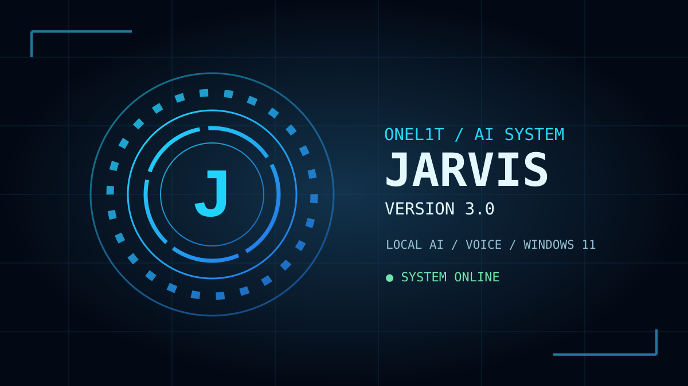

# ONEL1T JARVIS 3.0 — Windows 11 Desktop Assistant

An owner-controlled Ukrainian voice assistant with local Ollama AI, a resizable sci-fi HUD, and visible, **approval-gated** Windows automation. It is a prototype, not an administrator, an unrestricted autonomous agent, or remote-control software.



## Download only JARVIS

**[Download JARVIS 3.0 for Windows 11 (ZIP)](https://github.com/onel1t111252-bit/onel1t/raw/refs/heads/main/projects/jarvis/JARVIS_3_0_Windows11.zip)**

The archive contains Python sources, the Ollama Modelfile, installation scripts, dependencies and tests. It does not include Python, installed Ollama models, Steam, private files or credentials.

## Install (Windows 11 / Python 3.12)

1. Install Python 3.12 and [Ollama](https://ollama.com/download).
2. Download and extract the ZIP. Start JARVIS from that extracted folder.
3. If Ollama does not already contain a model called `jarvis`, run `INSTALL_AI.bat`. It may download a large Qwen model. Existing models are not overwritten.
4. Run `INSTALL_VOICE.bat` once to install audio and foreground UI dependencies.
5. Run `START_JARVIS.bat`, click **CHECK AI**, then **TEST VOICE**.
6. JARVIS opens as a **normal, resizable window**, not fullscreen. Use **WINDOW: COMPACT / LARGE** to change its preset size; resizing by dragging a window edge is also supported.

Your old settings from a previous extracted folder are not copied automatically; you can change volume and window size in the app. If AI chat is unavailable, the fixed, explicitly defined local commands still work.

## More natural Ukrainian replies — «Так, сер»

The assistant uses a courteous, calm Ukrainian persona in its local Ollama prompt. Short command acknowledgements use **«Так, сер»**, **«Є, сер»** and, if execution fails, **«Перепрошую, сер»**. No text claims an app opened or a game started unless JARVIS has actually invoked the corresponding action; sending a Steam launch URI does **not** prove the game started.

The voice remains the Ukrainian male **JARVIS DEEP** (modified Ostap), not a recording or imitation of an actor.

## Separate voice volume control

The **VOICE VOLUME** slider (0–100%) changes the playback volume of the **assistant's voice only**. It does **not** modify overall Windows speaker volume, music, Steam, games or other apps. The setting is stored locally in `settings.json` and reloaded on next launch. It takes effect for the **next spoken reply**, including the **TEST VOICE** button.

The slider applies to online Microsoft Ukrainian voice synthesis (played with pygame) and to the optional local Windows SAPI mode. If an approved Ukrainian male SAPI voice is not installed, JARVIS reports an error rather than silently switching to English or a different gender.

## Sample commands

| Spoken or typed command | Action |
| --- | --- |
| `Джарвіс, відкрий Steam і запусти Доту` | Uses fixed `steam://run/570` URI |
| `відкрий Discord` | Finds a Start-menu program, asks approval |
| `покажи відкриті вікна` | Shows visible window titles locally |
| `перемкнись на Блокнот` | Requests permission before focusing a visible window |
| `надрукуй Привіт, Україно!` | Requests permission before Unicode typing |
| `скопіюй`, `встав`, `виділи все`, `збережи` | Safe foreground keyboard shortcuts after approval |
| `прокрути вниз`, `клацни мишею` | Scroll / one click at current cursor after approval |
| `відкрий блокнот, потім надрукуй Привіт` | Up to four explicit steps, each approved separately |

## Safety, privacy and limitations

- JARVIS runs **locally**, only under your signed-in Windows user permissions. It cannot bypass system privilege prompts.
- HANDS-FREE is **off by default**. If enabled, microphone audio is sent to Google's online speech recognizer. Press-to-talk also uses online recognition.
- The default neural voice sends the spoken **text** to Microsoft's online voice service. The `windows` voice profile uses a local Windows voice if an Ukrainian male SAPI voice is installed.
- Ollama AI chat runs on `127.0.0.1:11434`.
- Dictated text and window titles are **not** sent to speech synthesis for UI-typing/window-list actions. Action logs record action type and success/error, not typed text.
- Every foreground click, typing, key, window switch or multi-step operation requires visible approval. **STOP PLAN** cancels pending steps but cannot reliably interrupt an action already executing.
- Password entry, unreviewed scripts, remote access, unrestricted shell execution and system-privilege escalation are deliberately unsupported.
- Avoid payments, password fields, private chats and computers managed by an employer without permission.

## Tests

Run from the extracted folder:

```powershell
python -m py_compile jarvis.py desktop_actions.py window_control.py command_sequences.py assistant_persona.py voice_engine.py
python -m unittest discover -p "test_*.py" -v
```

The repository contains a GitHub Actions workflow testing Python syntax and pure logic on Windows and Ubuntu. **CI does not verify live microphone recognition, actual voice sound, Tk visual layout on a physical screen, Windows foreground mouse/keyboard, or Steam/Dota installation.** Test those locally when you have access to your PC.

## Source overview

- `jarvis.py` — UI, local chat, settings, actions and approval flow
- `voice_engine.py` — Ukrainian speech, 0–100% playback level
- `assistant_persona.py` — concise Ukrainian sir-style action acknowledgements
- `desktop_actions.py`, `window_control.py` — allowlisted local desktop actions
- `command_sequences.py` — fixed multi-command splitter
- `Modelfile` — initial Ollama assistant persona
- `test_*.py` — command, permission, voice level and persona tests

## License

MIT. Independent fan-inspired interface; not affiliated with Marvel, Valve or other rights holders.
